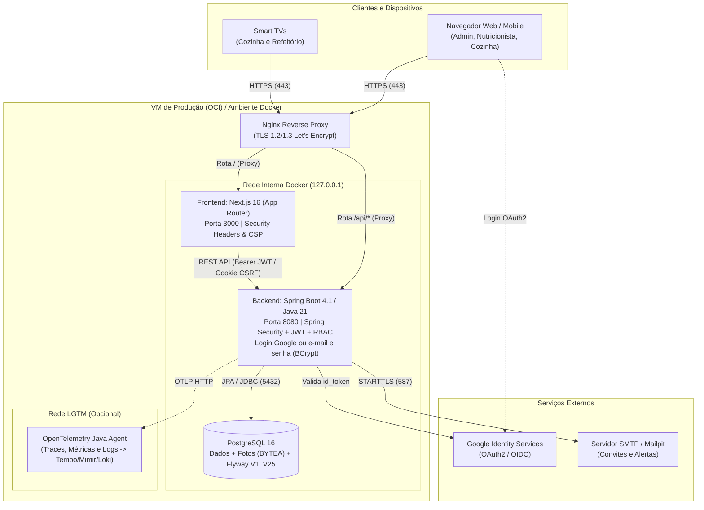

# Gestão de Refeitório — IFPE Campus Belo Jardim

[](https://github.com/ifpebj-ti/gestao-refeitorio/actions/workflows/ci.yml)
[](https://github.com/ifpebj-ti/gestao-refeitorio/actions/workflows/security.yml)
[](https://github.com/ifpebj-ti/gestao-refeitorio/actions/workflows/cd.yml)
[](https://github.com/ifpebj-ti/gestao-refeitorio/releases)
[](LICENSE)
[](docs/TESTES.md)
[](docs/TESTES.md)


Plataforma web, responsiva para celular, de controle de estoque da cozinha do campus: produtos, entradas e saídas por local de armazenamento, produção interna, validade e alertas, cardápio com projeção de consumo, notas de recebimento e relatórios.

**Aplicação em produção:** https://gestao-refeitorio-ifpe.duckdns.org
O login é feito com uma conta Google previamente cadastrada ou com e-mail e senha definidos pelo ADMIN.

**Links rápidos:** [Aplicação](https://gestao-refeitorio-ifpe.duckdns.org) · [Wiki](https://github.com/ifpebj-ti/gestao-refeitorio/wiki) · [Protótipo (Figma)](https://www.figma.com/design/4ndEJajgHfDGwRlFqvI7so/Gest%C3%A3o-Refeit%C3%B3rio---Esbo%C3%A7o-Baixa-Fidelidade?node-id=0-1&t=lGlpIrKxmdAmCb68-1) · [Board do projeto](https://github.com/orgs/ifpebj-ti/projects/44) · [Slides das sprints (Canva)](https://canva.link/ustmtgp8jaz1lkr) · [Documentação técnica](#documentação)

## Sumário

- [Para os professores: testes com usuário e senha](#para-os-professores-testes-com-usuário-e-senha)
- [Funcionalidades](#funcionalidades)
- [Perfis de acesso](#perfis-de-acesso)
- [Arquitetura e stack](#arquitetura-e-stack)
- [Como rodar localmente](#como-rodar-localmente)
- [Variáveis de ambiente](#variáveis-de-ambiente)
- [Segurança](#segurança)
- [CI/CD](#cicd)
- [Documentação](#documentação)
- [Equipe](#equipe)
- [Licença](#licença)

---

## Para os professores: testes com usuário e senha

Além do Google, a aplicação aceita login com **e-mail e senha** em todos os ambientes, inclusive na aplicação publicada (homologação). Nenhuma senha fica no repositório: as contas de teste de cada perfil são criadas pelo ADMIN, e as credenciais são entregues por canal privado.

### Como as contas de teste são criadas

1. Um **ADMIN local** (e-mail e senha, sem Google) é criado na subida da aplicação a partir das variáveis `ADMIN_LOCAL_EMAIL`, `ADMIN_LOCAL_NOME` e `ADMIN_LOCAL_SENHA`, definidas só no `.env` do servidor.
2. O ADMIN cadastra os usuários de teste (`POST /api/usuarios`) e define a senha de cada um com `PUT /api/usuarios/{id}/senha` (corpo `{"senha": "..."}`, mínimo de 12 caracteres).
3. As credenciais são enviadas ao professor por canal privado.
4. Ao fim dos testes, o ADMIN revoga o acesso com `DELETE /api/usuarios/{id}/senha` (o usuário volta a entrar só pelo Google) ou desativando a conta.

### Como obter o token

Troque a URL por `http://localhost:8080/api/auth/local` se estiver rodando na sua máquina.

bash:

```bash
curl -s -X POST https://gestao-refeitorio-ifpe.duckdns.org/api/auth/local \
  -H "Content-Type: application/json" \
  -d '{"email":"EMAIL_RECEBIDO","senha":"SENHA_RECEBIDA"}'
```

PowerShell:

```powershell
$resposta = Invoke-RestMethod -Method Post -Uri https://gestao-refeitorio-ifpe.duckdns.org/api/auth/local `
  -ContentType "application/json" `
  -Body '{"email":"EMAIL_RECEBIDO","senha":"SENHA_RECEBIDA"}'
$resposta.token
```

- A resposta traz o campo `token`, que vai no cabeçalho `Authorization: Bearer <token>`.
- E-mail inexistente, senha errada, usuário sem senha local ou inativo devolvem **401**, sempre com a mesma mensagem.
- Após **5 tentativas erradas seguidas** para o mesmo e-mail, o login fica bloqueado por **15 minutos** (**429**, com `Retry-After`). Redefinir a senha libera o bloqueio na hora.
- Em produção o Swagger fica desligado; localmente ele está em http://localhost:8080/swagger-ui.html (**Authorize** → colar o token).

### Resultados esperados

| Teste | NUTRICIONISTA | COZINHA | Sem token |
|---|---|---|---|
| `GET /api/produtos` | 200 | 200 | 401 |
| `GET /api/remetentes` | 200 | **403** | 401 |
| `GET /api/usuarios` | **403** | **403** | 401 |

- **401:** a requisição não tem token válido (ausente, inválido ou expirado).
- **403:** o token é válido, mas o perfil não tem permissão para o endpoint.

Em endpoints que recebem um corpo (`POST`/`PUT`/`PATCH`), a validação dos dados acontece antes da checagem de perfil. Por isso, um corpo inválido devolve 400 mesmo para quem não tem permissão. Para ver o 403 nesses endpoints, envie um corpo válido.

### Permissões por endpoint

A autorização é validada sempre no backend, com `@PreAuthorize` em cada endpoint. Esconder telas no frontend é só conveniência.

| Endpoint | Perfis permitidos |
|---|---|
| `POST /api/auth/google`, `POST /api/auth/logout` | público |
| `POST /api/auth/local` | público (login com e-mail e senha; bloqueio após 5 erros) |
| `GET /api/auth/me` | qualquer perfil autenticado |
| `GET /api/versao` (versão da aplicação em execução) | qualquer perfil autenticado |
| `GET /api/produtos`, `GET /api/produtos/{id}`, `GET /api/produtos/{id}/saldo-por-local`, `GET /api/produtos/{id}/movimentacoes` | qualquer perfil autenticado |
| `POST /api/produtos`, `PATCH /api/produtos/{id}/unidade-medida`, `.../quantidade-minima`, `.../valor-referencia`, `.../controle-validade`, `DELETE /api/produtos/{id}` | `NUTRICIONISTA` |
| `POST /api/movimentacoes/entrada` | `NUTRICIONISTA` |
| `POST /api/movimentacoes/saida`, `POST /api/movimentacoes/{id}/foto` | `NUTRICIONISTA`, `COZINHA` |
| `GET /api/movimentacoes`, `GET /api/movimentacoes/{id}/foto` | qualquer perfil autenticado |
| `POST /api/producoes-internas` | `NUTRICIONISTA`, `COZINHA` |
| `POST /api/cardapios` | `NUTRICIONISTA` |
| `GET /api/cardapios`, `GET /api/cardapios/{id}`, `GET /api/cardapios/projecao-consumo` | qualquer perfil autenticado |
| `/api/notas/**` | `NUTRICIONISTA` |
| `/api/remetentes/**` | `NUTRICIONISTA` |
| `/api/relatorios/**` (mensal, PDF, Excel e consumo) | `NUTRICIONISTA` |
| `PUT /api/usuarios/{id}/senha`, `DELETE /api/usuarios/{id}/senha` (definir e remover a senha local) | `ADMIN` |
| `/api/usuarios/**` | `ADMIN` |

---

## Funcionalidades

- Cadastro de produtos com categoria, unidade de medida, valor de referência, quantidade mínima e controle de validade.
- Entradas, conferidas pela nutricionista, com origem (externa, agroindústria ou interna), lote, validade e foto opcional.
- Saídas por consumo, perda, descarte ou outro motivo.
- Saldo calculado por produto **e** por local de armazenamento, sem permitir saldo negativo.
- Produção interna, com setor de origem e responsável.
- Alertas de estoque baixo e de validade próxima, por job diário e, opcionalmente, por e-mail.
- Cardápio com projeção de consumo (quantidade por pessoa × pessoas estimadas) e tela para TV.
- Notas de recebimento vinculadas às entradas, com cadastro de remetentes.
- Relatório mensal consolidado, exportação em PDF e Excel e gráfico de consumo por período.
- Gestão de usuários pelo ADMIN, com convite por e-mail e controle do primeiro acesso.

## Perfis de acesso

| Perfil | Quem é | O que faz |
|---|---|---|
| `ADMIN` | Equipe técnica (TI) | Só gerencia usuários e suas senhas locais; não opera estoque nem catálogo. |
| `NUTRICIONISTA` | Nutricionista do campus | Gerencia o catálogo, confere entradas, cardápios, notas e relatórios. |
| `COZINHA` | Equipe da cozinha | Registra saídas, produção interna e fotos; consulta o estoque. |

Não existe auto-cadastro: um usuário só entra se o ADMIN já tiver cadastrado o e-mail dele. Pelo Google, um e-mail não cadastrado recebe 403. Pelo login com e-mail e senha, só entra quem tem uma senha local definida pelo ADMIN (ou o ADMIN local criado pelas variáveis de ambiente).

## Arquitetura e stack

| Camada | Tecnologias |
|---|---|
| Frontend | Next.js 16, React 19, TypeScript 6, Tailwind CSS 4 |
| Backend | Java 21, Spring Boot 4.1, Spring Security, Spring Data JPA, Flyway |
| Banco de dados | PostgreSQL 16 (as fotos também ficam no banco, em tabela própria) |
| Autenticação | Google OAuth2/OIDC ou e-mail e senha (BCrypt) + JWT próprio da aplicação; RBAC com `@PreAuthorize` |
| Infraestrutura | Docker Compose, Nginx com TLS (Let's Encrypt), VM na OCI |
| CI/CD e segurança | GitHub Actions, Release Please, Semgrep, Trivy, CodeQL, Dependabot, Cosign |

### Diagrama de Arquitetura



As decisões arquiteturais detalhadas (ADRs) estão registradas em [docs/adr/](docs/adr/README.md).

O backend é organizado em camadas, sempre na ordem controller → service → repository:

```
backend/src/main/java/br/ifpe/gestaorefeitorio/
├── controller/   # recebe a requisição, valida o DTO, chama o service
├── service/      # regras de negócio (interface + implementação)
├── repository/   # acesso a dados (Spring Data JPA)
├── model/        # entidades JPA e enums de domínio
├── dto/          # DTOs de requisição (validados) e de resposta
├── security/     # Google OAuth2, senha local (BCrypt), JWT, filtros, RBAC
├── job/          # jobs agendados (alertas, inicializadores)
└── exception/    # exceções de domínio e handler global
```

O modelo de dados, com diagrama, dicionário e regras de integridade, está em [docs/MODELAGEM_DADOS.md](docs/MODELAGEM_DADOS.md).

## Como rodar localmente

```bash
cp .env.example .env      # defina ao menos JWT_SECRET (32+ caracteres)
docker compose up -d --build
```

| Serviço | Endereço |
|---|---|
| Frontend | http://localhost:3000 |
| Backend | http://localhost:8080 |
| Swagger | http://localhost:8080/swagger-ui.html |
| Health check | http://localhost:8080/actuator/health |
| Mailpit (e-mails de dev) | http://localhost:8025 |

O `docker-compose.override.yml`, aplicado automaticamente em dev, publica as portas e sobe o Mailpit, que captura os e-mails enviados. As migrations do Flyway rodam sozinhas na subida.

O guia completo está em [GUIA_EXECUCAO.md](GUIA_EXECUCAO.md). Ele cobre como rodar só o backend, como rodar os testes (Testcontainers) e a solução de problemas no Windows.

## Variáveis de ambiente

Os valores ficam no `.env`, que não é versionado. O modelo é o [.env.example](.env.example).

| Variável | Uso |
|---|---|
| `DB_NAME`, `DB_USER`, `DB_PASSWORD` | Banco PostgreSQL |
| `JWT_SECRET` | Assinatura dos tokens (obrigatório, 32+ caracteres) |
| `GOOGLE_CLIENT_ID`, `GOOGLE_CLIENT_SECRET` | Login com Google |
| `APP_URL_FRONTEND` | Origens aceitas no CORS (separadas por vírgula) |
| `APP_URL_LOGIN` | Link da tela de login enviado no convite |
| `APP_VERSION` | Versão exibida no menu lateral (`GET /api/versao`); em produção vem da tag implantada; sem ela, `dev` |
| `ADMIN_INICIAL_EMAIL`, `ADMIN_INICIAL_NOME` | Primeiro ADMIN via Google, criado se não houver nenhum ativo |
| `ADMIN_LOCAL_EMAIL`, `ADMIN_LOCAL_NOME`, `ADMIN_LOCAL_SENHA` | ADMIN com login por e-mail e senha (senha com 12+ caracteres), criado na subida se o e-mail não existir; nunca sobrescreve uma senha já definida |
| `MAIL_HOST`, `MAIL_PORT`, `MAIL_USERNAME`, `MAIL_PASSWORD`, `MAIL_FROM` | SMTP |
| `ALERTA_EMAIL_HABILITADO` | Envio dos alertas por e-mail (`false` = só registra no log) |

## Segurança

- Login via Google (o backend valida o `id_token` junto ao Google) ou com e-mail e senha, guardada só como hash BCrypt, com bloqueio de 15 minutos após 5 tentativas erradas. Nos dois casos o backend emite o próprio JWT. A senha local é definida e revogada apenas pelo ADMIN. A decisão de aceitar os dois formatos de login está registrada no [ADR 0001](docs/adr/0001-autenticacao-hibrida-google-oidc-e-jwt-local.md).
- Respostas diferentes para requisição não autenticada (401) e para perfil sem permissão (403). E-mail não cadastrado e usuário inativo recebem a mesma resposta genérica, para não revelar quais contas existem.
- Entrada validada por Bean Validation nos DTOs. Consultas sempre parametrizadas (JPA). Fotos aceitas só em JPEG ou PNG, com o tipo conferido pela assinatura do arquivo (e não pelo nome ou pelo `Content-Type` declarado), e guardadas no banco, nunca em caminho de disco escolhido pelo cliente.
- Proteção CSRF: requisições que alteram dados e se autenticam só pelo cookie de sessão precisam de token CSRF (senão, 403). Chamadas com `Authorization: Bearer`, como as do frontend, não são afetadas. Em produção, os cookies são `HttpOnly`, `SameSite=Lax` e `Secure`.
- Segredos só por variáveis de ambiente. Tokens, senhas e `id_token` nunca vão para os logs.
- Em produção, o Swagger fica desligado e as portas do backend e do frontend ficam restritas à própria VM, atrás do Nginx com TLS.
- A política de segurança e o canal de reporte de vulnerabilidades estão em [SECURITY.md](SECURITY.md). A modelagem de ameaças está na [Wiki](https://github.com/ifpebj-ti/gestao-refeitorio/wiki).

## CI/CD

Todo pull request para a `main` passa por lint, verificação de tipos, build, testes do backend (unitários e de integração com PostgreSQL real via Testcontainers), SAST com Semgrep, revisão de dependências e scan das imagens com Trivy.

Depois do merge, as imagens vão para o GHCR, e o Release Please calcula a versão (SemVer) a partir dos Conventional Commits. Cada release assina as imagens com Cosign, gera os SBOMs e faz o deploy em produção, com health check e rollback automático.

Os detalhes estão em [docs/CI_CD.md](docs/CI_CD.md). O histórico de versões está no [CHANGELOG.md](CHANGELOG.md).

## Documentação

- [Wiki do repositório](https://github.com/ifpebj-ti/gestao-refeitorio/wiki): Documento de Visão, Arquitetura e Modelagem de Ameaças.
- [Protótipo no Figma](https://www.figma.com/design/4ndEJajgHfDGwRlFqvI7so/Gest%C3%A3o-Refeit%C3%B3rio---Esbo%C3%A7o-Baixa-Fidelidade?node-id=0-1&t=lGlpIrKxmdAmCb68-1): esboço de baixa fidelidade das telas do sistema.
- Acompanhamento do projeto:
  - [Board no GitHub Projects](https://github.com/orgs/ifpebj-ti/projects/44): backlog, sprints e andamento das issues;
  - [Slides das sprints (Canva)](https://canva.link/ustmtgp8jaz1lkr): apresentações de acompanhamento (Sprint Report).
- [docs/adr/](docs/adr/README.md): registros de decisões arquiteturais (ADRs).
- [docs/Analise-de-Concorrencia.md](docs/Analise-de-Concorrencia.md): análise comparativa de soluções de mercado e diferenciais do sistema.
- [docs/Guia-de-Testes-de-Usuario.md](docs/Guia-de-Testes-de-Usuario.md): roteiro e cenários de validação funcional com usuários.
- [GUIA_EXECUCAO.md](GUIA_EXECUCAO.md): execução, configuração, testes e solução de problemas.
- [docs/CI_CD.md](docs/CI_CD.md): esteira, releases, deploy e rollback.
- [docs/TESTES.md](docs/TESTES.md): testes automatizados, relatório de cobertura (JaCoCo) e gate de 70%.
- [docs/MODELAGEM_DADOS.md](docs/MODELAGEM_DADOS.md): modelo de dados.
- [docs/BACKUP_POSTGRES.md](docs/BACKUP_POSTGRES.md): backup e restauração do banco.
- [docs/OBSERVABILIDADE.md](docs/OBSERVABILIDADE.md): logs, traces e métricas com OpenTelemetry e LGTM.
- [SECURITY.md](SECURITY.md): política de segurança.

## Equipe

| Nome | Papel | GitHub |
|---|---|---|
| Ismaylla | Backend | [@Ismaylla](https://github.com/Ismaylla) |
| Raphaela Samille | Frontend | [@imsamille](https://github.com/imsamille) |
| Kauanne Cavalcante | Infraestrutura e DevSecOps | [@KauanneC](https://github.com/KauanneC) |

## Licença

Distribuído sob a licença Apache 2.0. Veja [LICENSE](LICENSE).
