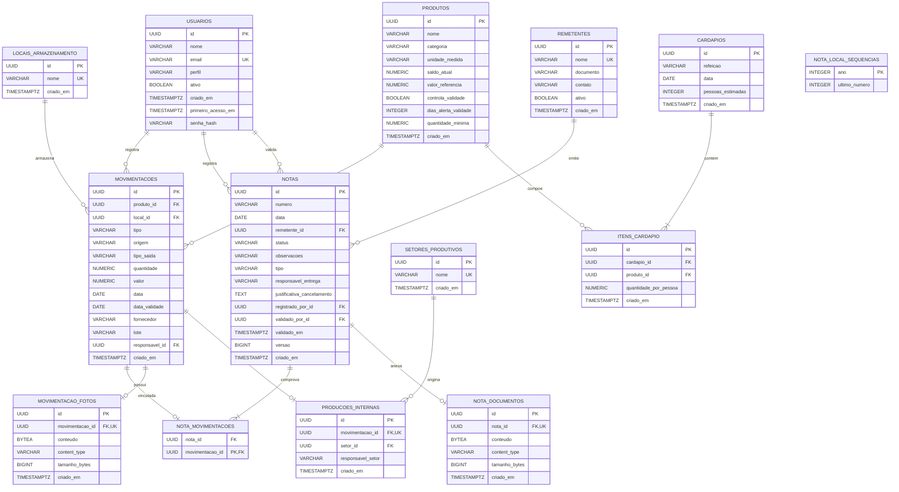

# Modelagem de Dados

## 1. Introdução

Este documento descreve a modelagem de dados do **Gestão Refeitório**, considerando o estado atual das migrations Flyway e das entidades JPA do backend.

O sistema utiliza:

- PostgreSQL como sistema gerenciador de banco de dados;
- UUID como identificador primário das entidades;
- Flyway para criação e evolução versionada do esquema;
- Spring Data JPA/Hibernate para o mapeamento objeto-relacional;
- `TIMESTAMPTZ` para datas e horas de auditoria;
- `NUMERIC` para quantidades e valores monetários, evitando perda de precisão.

As migrations são a fonte oficial da estrutura física do banco e estão em `backend/src/main/resources/db/migration`.

## 2. Visão geral do modelo

O modelo está dividido nos seguintes domínios:

| Domínio | Tabelas | Responsabilidade |
|---|---|---|
| Acesso | `usuarios` | Identidade, perfil, situação e senha local opcional dos usuários. |
| Estoque | `produtos`, `locais_armazenamento`, `movimentacoes`, `movimentacao_fotos` | Catálogo, saldos, entradas, saídas, armazenamento e evidências. |
| Produção interna | `setores_produtivos`, `producoes_internas` | Origem interna de produtos recebidos pelo refeitório. |
| Cardápio | `cardapios`, `itens_cardapio` | Planejamento das refeições e projeção de consumo. |
| Notas | `notas`, `remetentes`, `nota_movimentacoes` | Registro e validação de notas de recebimento, vinculadas às entradas que comprovam. |

## 3. Diagrama entidade-relacionamento



Legenda:

- `PK`: chave primária;
- `FK`: chave estrangeira;
- `UK`: restrição de unicidade;
- `||`: exatamente um;
- `o|`: zero ou um;
- `o{`: zero ou muitos;
- `|{`: um ou muitos no modelo de negócio.

## 4. Dicionário de dados

### 4.1. `usuarios`

Armazena as identidades autorizadas a utilizar o sistema.

| Coluna | Tipo | Restrições | Descrição |
|---|---|---|---|
| `id` | `UUID` | PK, `DEFAULT gen_random_uuid()` | Identificador do usuário. |
| `nome` | `VARCHAR(255)` | `NOT NULL` | Nome completo. |
| `email` | `VARCHAR(255)` | `NOT NULL`, `UNIQUE` | E-mail utilizado como identidade de acesso. |
| `perfil` | `VARCHAR(30)` | `NOT NULL` | Perfil de autorização. |
| `ativo` | `BOOLEAN` | `NOT NULL`, padrão `TRUE` | Indica se o acesso está habilitado. |
| `criado_em` | `TIMESTAMPTZ` | `NOT NULL`, padrão `now()` | Data e hora de criação. |
| `primeiro_acesso_em` | `TIMESTAMPTZ` | Opcional | Data e hora do primeiro login. Nulo enquanto o usuário nunca entrou; usado para decidir o reenvio do convite (V19). |
| `senha_hash` | `VARCHAR(100)` | Opcional | Hash BCrypt da senha local. Nulo quando o usuário só entra pelo Google (V25). |

Valores válidos na aplicação para `perfil`: `ADMIN`, `NUTRICIONISTA` e `COZINHA`.

A senha local nunca é armazenada em texto: só o hash BCrypt, definido ou removido pelo ADMIN (`PUT`/`DELETE /api/usuarios/{id}/senha`) ou pelo ADMIN local criado a partir das variáveis de ambiente.

### 4.2. `produtos`

Mantém o catálogo de insumos e os parâmetros de controle de estoque.

| Coluna | Tipo | Restrições | Descrição |
|---|---|---|---|
| `id` | `UUID` | PK, `DEFAULT gen_random_uuid()` | Identificador do produto. |
| `nome` | `VARCHAR(255)` | `NOT NULL` | Nome do insumo. |
| `categoria` | `VARCHAR(100)` | `NOT NULL` | Categoria usada na organização e nos filtros. |
| `unidade_medida` | `VARCHAR(20)` | `NOT NULL` | Unidade como kg, L ou un. |
| `saldo_atual` | `NUMERIC(12,3)` | `NOT NULL`, padrão `0` | Saldo consolidado do produto. |
| `valor_referencia` | `NUMERIC(12,2)` | Opcional | Valor utilizado como referência. |
| `controla_validade` | `BOOLEAN` | `NOT NULL`, padrão `FALSE` | Habilita o acompanhamento de validade. |
| `dias_alerta_validade` | `INTEGER` | Opcional | Antecedência do alerta de validade. |
| `quantidade_minima` | `NUMERIC(12,3)` | Opcional | Limite para alerta de estoque baixo. |
| `criado_em` | `TIMESTAMPTZ` | `NOT NULL`, padrão `now()` | Data e hora de criação. |

### 4.3. `locais_armazenamento`

Representa os locais físicos onde os produtos são mantidos.

| Coluna | Tipo | Restrições | Descrição |
|---|---|---|---|
| `id` | `UUID` | PK, `DEFAULT gen_random_uuid()` | Identificador do local. |
| `nome` | `VARCHAR(100)` | `NOT NULL`, `UNIQUE` | Nome do local de armazenamento. |
| `criado_em` | `TIMESTAMPTZ` | `NOT NULL`, padrão `now()` | Data e hora de criação. |

Os dados iniciais criados pelas migrations são `Despensa` e `Congelados/Refrigerados`, com UUIDs fixos que o frontend referencia. A V4 cria os dois locais. A V29 os recria, com os mesmos UUIDs, onde a tabela tiver sido esvaziada, e não altera nada onde eles já existem. A lista fica disponível em `GET /api/locais-armazenamento` para qualquer perfil autenticado.

### 4.4. `movimentacoes`

Registra as entradas e saídas de produtos e forma o histórico de estoque.

| Coluna | Tipo | Restrições | Descrição |
|---|---|---|---|
| `id` | `UUID` | PK, `DEFAULT gen_random_uuid()` | Identificador da movimentação. |
| `produto_id` | `UUID` | FK para `produtos`, `NOT NULL` | Produto movimentado. |
| `local_id` | `UUID` | FK para `locais_armazenamento`, `NOT NULL` | Local afetado. |
| `tipo` | `VARCHAR(10)` | `NOT NULL` | `ENTRADA` ou `SAIDA`. |
| `origem` | `VARCHAR(30)` | Condicional | Origem de uma entrada. |
| `tipo_saida` | `VARCHAR(20)` | Condicional | Motivo de uma saída. |
| `quantidade` | `NUMERIC(12,3)` | `NOT NULL` | Quantidade movimentada. |
| `valor` | `NUMERIC(12,2)` | Condicional | Valor de compra da entrada. |
| `data` | `DATE` | `NOT NULL` | Data da movimentação. |
| `data_validade` | `DATE` | Opcional | Validade do lote recebido. |
| `fornecedor` | `VARCHAR(150)` | Opcional | Fornecedor ou cooperativa de origem. |
| `lote` | `VARCHAR(50)` | Opcional | Número do lote informado no recebimento. Nulo em saídas. |
| `responsavel_id` | `UUID` | FK para `usuarios`, `NOT NULL` | Usuário responsável pelo registro. |
| `criado_em` | `TIMESTAMPTZ` | `NOT NULL`, padrão `now()` | Data e hora de criação. |

Valores reconhecidos pela aplicação:

- `tipo`: `ENTRADA` ou `SAIDA`;
- `origem`: `EXTERNA`, `AGROINDUSTRIA`, `AGROPECUARIA` ou `INTERNA`;
- `tipo_saida`: `CONSUMO`, `PERDA`, `DESCARTE` ou `OUTRO`.

A constraint `chk_movimentacao_tipo_campos` garante que:

- uma entrada possua `origem` e não possua `tipo_saida`;
- uma saída possua `tipo_saida` e não possua `origem` nem `valor`.

### 4.5. `movimentacao_fotos`

Armazena a evidência fotográfica sem carregar o conteúdo binário nas consultas comuns de movimentações.

| Coluna | Tipo | Restrições | Descrição |
|---|---|---|---|
| `id` | `UUID` | PK, `DEFAULT gen_random_uuid()` | Identificador da foto. |
| `movimentacao_id` | `UUID` | FK, `NOT NULL`, `UNIQUE` | Movimentação relacionada. |
| `conteudo` | `BYTEA` | `NOT NULL` | Conteúdo binário da imagem. |
| `content_type` | `VARCHAR(100)` | `NOT NULL` | Tipo MIME do arquivo. |
| `tamanho_bytes` | `BIGINT` | `NOT NULL` | Tamanho do arquivo em bytes. |
| `criado_em` | `TIMESTAMPTZ` | `NOT NULL`, padrão `now()` | Data e hora de criação. |

A unicidade de `movimentacao_id` estabelece uma relação opcional de um para um: uma movimentação pode possuir, no máximo, uma foto.

### 4.6. `setores_produtivos`

Identifica os setores do campus que fornecem produção interna.

| Coluna | Tipo | Restrições | Descrição |
|---|---|---|---|
| `id` | `UUID` | PK, `DEFAULT gen_random_uuid()` | Identificador do setor. |
| `nome` | `VARCHAR(150)` | `NOT NULL`, `UNIQUE` | Nome do setor produtivo. |
| `criado_em` | `TIMESTAMPTZ` | `NOT NULL`, padrão `now()` | Data e hora de criação. |

### 4.7. `producoes_internas`

Complementa uma movimentação de entrada originada por um setor produtivo.

| Coluna | Tipo | Restrições | Descrição |
|---|---|---|---|
| `id` | `UUID` | PK, `DEFAULT gen_random_uuid()` | Identificador do recebimento interno. |
| `movimentacao_id` | `UUID` | FK, `NOT NULL`, `UNIQUE` | Movimentação de entrada correspondente. |
| `setor_id` | `UUID` | FK, `NOT NULL` | Setor que entregou o produto. |
| `responsavel_setor` | `VARCHAR(150)` | `NOT NULL` | Nome da pessoa que realizou a entrega. |
| `criado_em` | `TIMESTAMPTZ` | `NOT NULL`, padrão `now()` | Data e hora de criação. |

### 4.8. `cardapios`

Representa o planejamento de uma refeição para determinada data.

| Coluna | Tipo | Restrições | Descrição |
|---|---|---|---|
| `id` | `UUID` | PK, `DEFAULT gen_random_uuid()` | Identificador do cardápio. |
| `refeicao` | `VARCHAR(100)` | `NOT NULL` | Nome ou tipo da refeição. |
| `data` | `DATE` | `NOT NULL` | Data prevista. |
| `pessoas_estimadas` | `INTEGER` | `NOT NULL` | Quantidade estimada de pessoas. |
| `criado_em` | `TIMESTAMPTZ` | `NOT NULL`, padrão `now()` | Data e hora de criação. |

### 4.9. `itens_cardapio`

Associa os produtos ao cardápio e informa o consumo estimado por pessoa.

| Coluna | Tipo | Restrições | Descrição |
|---|---|---|---|
| `id` | `UUID` | PK, `DEFAULT gen_random_uuid()` | Identificador do item. |
| `cardapio_id` | `UUID` | FK, `NOT NULL` | Cardápio relacionado. |
| `produto_id` | `UUID` | FK, `NOT NULL` | Produto utilizado. |
| `quantidade_por_pessoa` | `NUMERIC(12,3)` | `NOT NULL` | Quantidade estimada por pessoa. |
| `criado_em` | `TIMESTAMPTZ` | `NOT NULL`, padrão `now()` | Data e hora de criação. |

A projeção total é calculada em tempo de leitura:

```text
consumo estimado = quantidade_por_pessoa × pessoas_estimadas
```

O valor calculado não é persistido, evitando redundância e inconsistência.

### 4.10. `notas`

Registra as notas de recebimento emitidas por um remetente e submetidas à validação. Produto, quantidade, lote e local não ficam na nota: vêm das entradas vinculadas a ela em `nota_movimentacoes`.

| Coluna | Tipo | Restrições | Descrição |
|---|---|---|---|
| `id` | `UUID` | PK, `DEFAULT gen_random_uuid()` | Identificador da nota. |
| `numero` | `VARCHAR(50)` | `NOT NULL`; único por remetente | Número do documento. |
| `data` | `DATE` | `NOT NULL` | Data da nota. |
| `remetente_id` | `UUID` | FK para `remetentes`, `NOT NULL` | Quem emitiu a nota (V23). |
| `status` | `VARCHAR(20)` | `NOT NULL`, padrão `PENDENTE` | Situação da validação. |
| `observacoes` | `VARCHAR(500)` | Opcional | Observações livres sobre a nota (V23). |
| `tipo` | `VARCHAR(10)` | `NOT NULL`, padrão `EXTERNA`, `CHECK` (`EXTERNA` ou `LOCAL`) | `EXTERNA`: recebida de terceiro, número informado. `LOCAL`: emitida pela cozinha, número gerado (V28). |
| `responsavel_entrega` | `VARCHAR(150)` | Opcional | Nome de quem entregou, em texto livre; preenchido nas notas locais (V28). |
| `justificativa_cancelamento` | `TEXT` | Opcional | Motivo informado ao cancelar a nota; nulo nas pendentes e validadas (V27). |
| `registrado_por_id` | `UUID` | FK para `usuarios`, `NOT NULL` | Usuário que registrou a nota (V23). |
| `validado_por_id` | `UUID` | FK para `usuarios`, opcional | Quem decidiu a nota: validou ou cancelou. |
| `validado_em` | `TIMESTAMPTZ` | Opcional | Quando a nota foi validada ou cancelada. |
| `versao` | `BIGINT` | `NOT NULL`, padrão `0` | Controle de concorrência otimista (`@Version`): de duas decisões simultâneas, só a primeira é gravada (V27). |
| `criado_em` | `TIMESTAMPTZ` | `NOT NULL`, padrão `now()` | Data e hora de criação. |

Valores reconhecidos pela aplicação para `status`: `PENDENTE`, `VALIDADA` e `CANCELADA`.

Transições permitidas: só `PENDENTE → VALIDADA` e `PENDENTE → CANCELADA` (esta exige justificativa). Uma nota validada ou cancelada não muda mais de status. Cancelar não estorna nem desvincula as entradas: elas continuam no estoque e ligadas à nota.

O número da nota é único por remetente (`uk_notas_remetente_numero`), não no sistema inteiro: dois remetentes podem emitir notas com o mesmo número. Nas notas `LOCAL`, o número é gerado no formato `NL-AAAA-NNNN` (ano da emissão no horário de Recife e sequencial de 4 dígitos), é único no sistema inteiro (`uk_notas_numero_local`), nunca é editado e não é reaproveitado, nem quando a nota é cancelada. A coluna `origem`, que existia até a V22, foi removida na V23; o remetente passou a ser uma entidade própria. A coluna `documento_url`, nunca usada, foi removida na V26: o documento digitalizado fica em `nota_documentos`.

### 4.11. `remetentes`

Cadastro de quem emite as notas de recebimento (fornecedores, cooperativas e setores do campus).

| Coluna | Tipo | Restrições | Descrição |
|---|---|---|---|
| `id` | `UUID` | PK, `DEFAULT gen_random_uuid()` | Identificador do remetente. |
| `nome` | `VARCHAR(150)` | `NOT NULL`; único sem diferenciar maiúsculas | Nome do remetente. |
| `documento` | `VARCHAR(14)` | Opcional | CPF ou CNPJ, só dígitos. |
| `contato` | `VARCHAR(150)` | Opcional | Telefone ou e-mail de contato. |
| `ativo` | `BOOLEAN` | `NOT NULL`, padrão `TRUE` | Remetente inativo não pode receber notas novas, mas continua nas antigas. |
| `criado_em` | `TIMESTAMPTZ` | `NOT NULL`, padrão `now()` | Data e hora de criação. |

### 4.12. `nota_movimentacoes`

Vincula cada nota às entradas de estoque que ela comprova.

| Coluna | Tipo | Restrições | Descrição |
|---|---|---|---|
| `nota_id` | `UUID` | FK para `notas`, `NOT NULL` | Nota que comprova a entrada. |
| `movimentacao_id` | `UUID` | PK, FK para `movimentacoes` | Entrada comprovada. Por ser a chave primária, uma entrada pertence a no máximo uma nota. |

A aplicação só permite vincular movimentações do tipo `ENTRADA`.

### 4.13. `nota_documentos`

Guarda o documento digitalizado da nota (NF-e do fornecedor ou cópia assinada), separado de `notas` para não carregar o arquivo nas consultas comuns. Mesma decisão de armazenamento de `movimentacao_fotos` (V26).

| Coluna | Tipo | Restrições | Descrição |
|---|---|---|---|
| `id` | `UUID` | PK, `DEFAULT gen_random_uuid()` | Identificador do documento. |
| `nota_id` | `UUID` | FK para `notas`, `NOT NULL`, `UNIQUE` | Nota a que o documento pertence. |
| `conteudo` | `BYTEA` | `NOT NULL` | Conteúdo binário do arquivo. |
| `content_type` | `VARCHAR(100)` | `NOT NULL` | `application/pdf`, `image/jpeg` ou `image/png`, conferido pela assinatura do arquivo. |
| `tamanho_bytes` | `BIGINT` | `NOT NULL` | Tamanho do arquivo em bytes (até 5MB). |
| `criado_em` | `TIMESTAMPTZ` | `NOT NULL`, padrão `now()` | Data e hora do primeiro anexo. |

Anexar o documento é opcional. Enquanto a nota está `PENDENTE`, um novo envio substitui o anterior; com a nota `VALIDADA` ou `CANCELADA`, o documento não pode mais ser alterado. O nome do arquivo enviado nunca é armazenado.

### 4.14. `nota_local_sequencias`

Guarda o último número de nota local emitido em cada ano (V28).

| Coluna | Tipo | Restrições | Descrição |
|---|---|---|---|
| `ano` | `INTEGER` | PK | Ano da emissão. |
| `ultimo_numero` | `INTEGER` | `NOT NULL` | Último sequencial emitido no ano. |

A linha do ano é criada na primeira emissão do ano e travada (`SELECT ... FOR UPDATE`) durante cada emissão. O incremento acontece na mesma transação da nota: se a emissão falhar, o número volta, sem deixar buraco; emissões simultâneas são atendidas uma depois da outra, sem repetir número. A sequência recomeça em `0001` a cada ano.

## 5. Relacionamentos e cardinalidades

| Origem | Destino | Cardinalidade | Chave estrangeira |
|---|---|---|---|
| `usuarios` | `movimentacoes` | 1:N | `movimentacoes.responsavel_id` |
| `usuarios` | `notas` | 1:N | `notas.registrado_por_id` |
| `usuarios` | `notas` | 1:N opcional (quem decidiu) | `notas.validado_por_id` |
| `remetentes` | `notas` | 1:N | `notas.remetente_id` |
| `notas` | `nota_movimentacoes` | 1:N | `nota_movimentacoes.nota_id` |
| `movimentacoes` | `nota_movimentacoes` | 1:0..1 | `nota_movimentacoes.movimentacao_id` |
| `notas` | `nota_documentos` | 1:0..1 | `nota_documentos.nota_id` |
| `produtos` | `movimentacoes` | 1:N | `movimentacoes.produto_id` |
| `locais_armazenamento` | `movimentacoes` | 1:N | `movimentacoes.local_id` |
| `movimentacoes` | `movimentacao_fotos` | 1:0..1 | `movimentacao_fotos.movimentacao_id` |
| `movimentacoes` | `producoes_internas` | 1:0..1 | `producoes_internas.movimentacao_id` |
| `setores_produtivos` | `producoes_internas` | 1:N | `producoes_internas.setor_id` |
| `cardapios` | `itens_cardapio` | 1:N | `itens_cardapio.cardapio_id` |
| `produtos` | `itens_cardapio` | 1:N | `itens_cardapio.produto_id` |

As chaves estrangeiras não declaram exclusão em cascata. O PostgreSQL aplica o comportamento padrão `NO ACTION`, impedindo a exclusão de um registro referenciado enquanto houver dependências.

## 6. Índices e unicidade

Além dos índices criados automaticamente para chaves primárias e restrições `UNIQUE`, existem:

| Índice | Tabela | Coluna | Finalidade |
|---|---|---|---|
| `idx_movimentacoes_produto` | `movimentacoes` | `produto_id` | Otimizar histórico e consultas por produto. |
| `idx_movimentacoes_data` | `movimentacoes` | `data` | Otimizar consultas e relatórios por período. |
| `idx_notas_status` | `notas` | `status` | Otimizar listagens por situação da nota. |
| `idx_nota_movimentacoes_nota` | `nota_movimentacoes` | `nota_id` | Buscar as entradas vinculadas a uma nota. |

Possuem unicidade explícita:

- `usuarios.email`;
- `locais_armazenamento.nome`;
- `setores_produtivos.nome`;
- `remetentes.nome`, sem diferenciar maiúsculas e minúsculas (índice único `uk_remetentes_nome_lower` sobre `LOWER(nome)`);
- `notas.remetente_id` + `notas.numero` (`uk_notas_remetente_numero`), ou seja, o número é único por remetente;
- `notas.numero` das notas `LOCAL` (índice único parcial `uk_notas_numero_local`, `WHERE tipo = 'LOCAL'`);
- `nota_local_sequencias.ano` (chave primária);
- `nota_movimentacoes.movimentacao_id` (chave primária);
- `nota_documentos.nota_id`;
- `movimentacao_fotos.movimentacao_id`;
- `producoes_internas.movimentacao_id`.

## 7. Regras de integridade

As principais regras de integridade são:

1. Toda movimentação referencia um produto, um local e um usuário responsável existentes.
2. Entradas exigem origem e não aceitam tipo de saída.
3. Saídas exigem tipo de saída e não aceitam origem nem valor de compra.
4. Uma movimentação possui, no máximo, uma foto, e uma nota possui, no máximo, um documento anexado.
5. Uma movimentação possui, no máximo, um detalhamento de produção interna.
6. E-mails de usuários, nomes de locais, nomes de setores e nomes de remetentes não podem se repetir; o número de uma nota não se repete para o mesmo remetente.
7. Toda nota tem um remetente e um usuário que a registrou; a nota local tem número gerado sequencial por ano, sem repetição nem buraco.
8. Uma movimentação é comprovada por, no máximo, uma nota.
9. Quantidades usam três casas decimais e valores monetários usam duas casas decimais.
10. Registros de domínio possuem UUID e data/hora de criação.

Validações adicionais, como saldo suficiente, valores positivos, autorização por perfil, coerência da data de validade, vínculo de notas só a entradas e bloqueio de notas para remetentes inativos, são realizadas pela camada de serviço da aplicação.

O saldo não é uma coluna: é sempre a soma das entradas menos as saídas do produto naquele local. Para que duas saídas simultâneas não enxerguem o mesmo saldo e o deixem negativo, o registro de saída trava a linha do produto em `produtos` (`SELECT ... FOR UPDATE`) antes de calcular o saldo. A trava vale até o fim da transação, então a segunda saída só calcula o saldo depois que a primeira foi gravada.

## 8. Evolução do banco de dados

O Flyway executa as migrations em ordem crescente. As migrations existentes vão de `V1` a `V29`.

Migrations que alteraram a estrutura do banco:

| Migration | Alteração |
|---|---|
| `V1` a `V12` | Estrutura inicial: usuários, produtos, locais, movimentações (entrada e saída), fotos, produção interna, quantidade mínima, cardápio, fornecedor e notas. |
| `V19` | `usuarios.primeiro_acesso_em`. |
| `V21` | `movimentacoes.lote`. |
| `V22` | Tabela `remetentes`. |
| `V23` | `notas` passa a ter remetente, quem registrou e observações; sai a coluna `origem`; número único por remetente; tabela `nota_movimentacoes`. |
| `V25` | `usuarios.senha_hash` (hash BCrypt da senha local). |
| `V26` | Tabela `nota_documentos`; sai a coluna `notas.documento_url`. |
| `V27` | `notas.justificativa_recusa` vira `justificativa_cancelamento`; nova coluna `notas.versao` (lock otimista). |
| `V28` | `notas.tipo` e `notas.responsavel_entrega`; índice único parcial `uk_notas_numero_local`; tabela `nota_local_sequencias`. |

As demais migrations só mexem em dados: carga e revisão do catálogo de produtos (`V8`, `V13` a `V17` e `V20`), usuários iniciais de homologação (`V18`), remoção dos que ficaram sem vínculo (`V24`) e restauração dos locais de armazenamento padrão (`V29`).

Para evoluir o modelo:

1. não altere uma migration já aplicada em qualquer ambiente compartilhado;
2. crie uma nova migration usando o padrão `V<numero>__<descricao>.sql`;
3. mantenha a migration compatível com dados já existentes;
4. atualize a entidade JPA correspondente;
5. adicione ou ajuste os testes automatizados;
6. atualize este documento quando tabelas, colunas, relacionamentos ou constraints forem alterados.

Exemplo:

```text
V30__adicionar_indice_movimentacao_local.sql
```

## 9. Considerações de segurança e privacidade

- A coluna `usuarios.senha_hash` guarda apenas o hash BCrypt da senha local, nunca a senha em texto. Ela é nula para quem só entra pelo Google, nunca aparece em respostas da API nem em logs, e só o ADMIN pode defini-la ou removê-la.
- E-mails são dados pessoais e não devem ser expostos em logs desnecessários.
- O conteúdo de `movimentacao_fotos` e de `nota_documentos` deve ser entregue apenas a usuários autorizados; o documento da nota só é servido à NUTRICIONISTA.
- Backups do PostgreSQL devem ser criptografados e ter acesso restrito.
- Credenciais do banco devem ser fornecidas por variáveis de ambiente ou secrets do ambiente de execução.
- Operações administrativas e movimentações devem preservar a identificação do usuário responsável.

## 10. Fontes de verdade

Em caso de divergência, devem ser consultadas nesta ordem:

1. migrations Flyway em `backend/src/main/resources/db/migration`;
2. entidades em `backend/src/main/java/br/ifpe/gestaorefeitorio/model`;
3. enums em `backend/src/main/java/br/ifpe/gestaorefeitorio/model/enums`;
4. este documento.

---

**Última atualização:** 16 de novembro de 2026.
